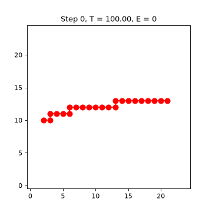
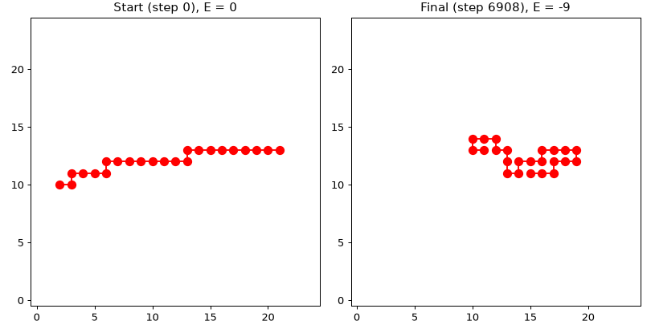
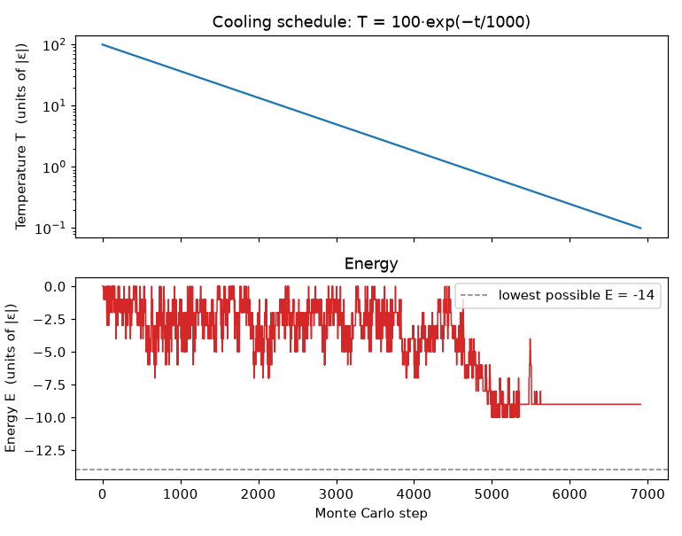

# 407-ProteinFolding

Final project for PHY407 (Fall 2026), topic 3: Protein Folding.

A Markov Chain Monte Carlo simulation with simulated annealing that folds a simplified 2D protein, starting from a shape you choose.

<p align="center">
  
</p>

## The model

- A protein is a chain of N identical monomers on a rectangular `width` × `height` lattice (25 × 25 by default).
- Monomer `i` is bonded to monomers `i-1` and `i+1`. Bonded monomers are always one lattice step apart, and no two monomers share a site.
- Every pair of monomers that are next to each other on the lattice but **not** bonded adds ε = −1 to the energy, so E = ε × (number of such contacts).
- No shape can have a lower energy than

  $$E_{\min} \ge \epsilon\,\big(N + 1 - \lceil 2\sqrt{N}\,\rceil\big)$$

  because N lattice sites can share at most 2N − ⌈2√N⌉ edges, and N − 1 of those are bonds. For N = 23 this gives −14. Some values of N can't reach the bound, so it's a floor, not a guaranteed target.

Temperatures are in units of |ε|/k<sub>B</sub>.

## How the simulation works

Each Monte Carlo step:

1. Lower the temperature: T = T<sub>start</sub> · e<sup>−t/τ</sup>, where t is the step number.
2. Pick a random monomer and a random diagonal step (±1, ±1). Keep picking until the move is allowed: the new site has to be inside the lattice, empty, and one step from the monomer's bonded neighbours. For a monomer in the middle of the chain, this is a "corner flip" across a bend. For an end monomer, it's a 90° turn around its neighbour.
3. Accept or reject the move with the Metropolis rule: always accept if the energy doesn't go up, otherwise accept with probability e<sup>−ΔE/T</sup>. A rejected move is undone.
4. Record T, E and a copy of the protein.

The run stops when T falls below T<sub>final</sub>, which takes about τ · ln(T<sub>start</sub>/T<sub>final</sub>) steps.

## Files

| File | Contents |
|---|---|
| [`main/protein_folding_toolkit.py`](main/protein_folding_toolkit.py) | The settings, `build_protein(moves)` for the starting shape, `plot_states()` for the animation. Running it runs the simulation. |
| [`main/build_protein.py`](main/build_protein.py) | The `Protein` class: monomer positions, `is_valid()`, `calc_energy()` and `Plot()`. |
| [`main/annealing_functions.py`](main/annealing_functions.py) | `acceptance()` (Metropolis rule), `cooledT()` (cooling schedule) and `discreteAnnealing()` (the simulation loop). |
| [`figures/`](figures) | The example run below. |

## Running it

You need Python 3 (tested on 3.11 and 3.14), NumPy and Matplotlib.

```bash
python main/protein_folding_toolkit.py
```

A window opens and shows the protein every 100 steps.

### Settings

The settings are at the top of `protein_folding_toolkit.py`:

```python
Tstart = 100   # initial temperature
Tfinal = 0.1   # final temperature
tau = 1000     # decay constant, in Monte Carlo steps
```

### Starting shape

Give the starting shape as a string of moves, one letter per bond: **R**ight, **L**eft, **U**p, **D**own. You start at one end of the chain and say which way each next monomer goes. A string of length N − 1 gives N monomers, centred in the lattice.

```python
initialProtein, N = build_protein('RURRRURRRRRRRURRRRRRRR')   # 23 monomers
initialProtein, N = build_protein('R' * 14)                  # straight chain of 15
initialProtein, N = build_protein('LURRRRRRRURRDL')          # Figure 2 of the project spec (E = -3)
```

A string can't produce a broken chain, since every letter is one lattice step. If the shape runs into itself or leaves the lattice, `Protein` prints what's wrong.

## Example run

This run uses the settings above, the 23-monomer starting shape `RURRRURRRRRRRURRRRRRRR` and `random.seed(2)`.

It took 6,908 steps, and the energy went from 0 to **−9** (the lowest it reached was −10, near step 5,000).

| Start and final shape |
|---|
|  |

| Cooling schedule and energy |
|---|
|  |

### Repeated runs

Over 10 runs with the same settings (seeds 0–9):

- The final energies were −6, −8, −9, −9, −9, −10, −10, −6, −10 and −11.
- The mean was −8.8, with a standard deviation of 1.6.
- None reached the floor of −14.
- Each run took about 0.25 s.

The run above (seed 2) is a typical one.

### What the example shows

- **The protein barely folds while T is above about 2.** At those temperatures almost every move is accepted, so most of the run happens before anything stays folded. A lower T<sub>start</sub> spends more of the run where folding happens.
- **Cooling more slowly folds further.** With τ = 5000 (34,539 steps), three runs ended at −11, −11 and −12.

## Checks

- The protein in Figure 2 of the project spec (`build_protein('LURRRRRRRURRDL')`) gives E = −3, matching the spec's 3ε.
- After every accepted move the chain stays valid (`is_valid()` returns `True`), and the recorded energy matches `calc_energy()`.
