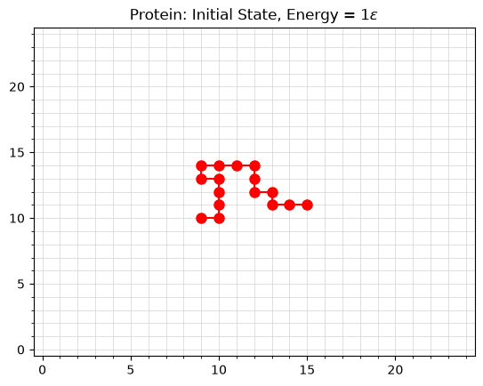
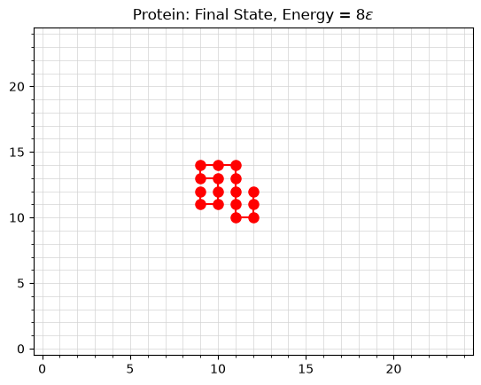
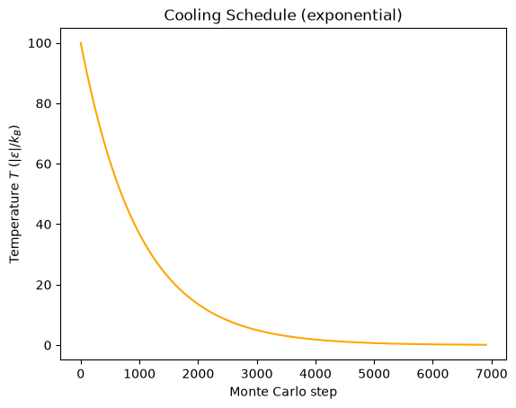
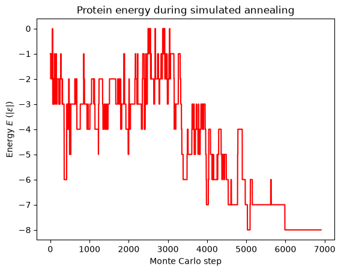

# 407-ProteinFolding

Final project for PHY407 (Fall 2026), Protein Folding.

A Markov Chain Monte Carlo simulation with simulated annealing that folds a simplified 2D protein, starting from a shape you choose.

## The model

- A protein is a chain of N identical monomers on a rectangular `width` × `height` lattice (25 × 25 by default).
- Monomer `i` is bonded to monomers `i-1` and `i+1`. Bonded monomers are always one lattice step apart, and no two monomers share a site.
- Every pair of monomers that are next to each other on the lattice but **not** bonded adds ε = −1 to the energy, so E = ε × (number of such contacts).

Temperatures are in units of |ε|/k<sub>B</sub>.

## How the simulation works

Each Monte Carlo step:

1. Lower the temperature following the cooling schedule, where t is the step number. The default is exponential, T = T<sub>start</sub> · e<sup>−t/τ</sup>; linear and inverse schedules are also available.
2. Pick a random monomer and a random diagonal step (±1, ±1). The move is allowed only if the new site is inside the lattice, empty, and one step from the monomer's bonded neighbours. For a monomer in the middle of the chain, this is a "corner flip" across a bend. For an end monomer, it's a 90° turn around its neighbour. A move that isn't allowed counts as a rejected step.
3. Accept or reject an allowed move with the Metropolis rule: always accept if the energy doesn't go up, otherwise accept with probability e<sup>−ΔE/T</sup>. A rejected move is undone.
4. Record T, E and a copy of the protein.

The run stops when T reaches T<sub>final</sub>, which takes about τ · ln(T<sub>start</sub>/T<sub>final</sub>) steps with the exponential schedule.

## Files

| File | Contents |
|---|---|
| [`src/protein_folding_toolkit.py`](src/protein_folding_toolkit.py) | The settings, `build_protein(moves)` for the starting shape, `plot_states()` for the animation. Running it runs the simulation. |
| [`src/protein.py`](src/protein.py) | The `Protein` class: monomer positions, `is_valid()`, `calc_energy()` and `Plot()`. |
| [`src/annealing_functions.py`](src/annealing_functions.py) | `acceptance()` (Metropolis rule), the cooling schedules `exponential_cooling()`, `linear_cooling()` and `inverse_cooling()`, and `discreteAnnealing()` (the simulation loop). |

## Running it

You need Python 3, NumPy and Matplotlib. To install them:

```bash
pip install -r requirements.txt
```

Then run:

```bash
python src/protein_folding_toolkit.py
```

It shows four figures one after another (close each window to see the next): the starting structure, the final structure, the cooling schedule and the energy against Monte Carlo step.

### Settings

The settings are at the top of `protein_folding_toolkit.py`:

```python
Tstart = 100                   # initial temperature
Tfinal = 0.1                   # final temperature: the run stops once T reaches this
tau = 1000                     # time constant of the cooling schedule, in Monte Carlo steps
schedule_name = 'exponential'  # or 'linear' or 'inverse'
seed_num = 1                   # seed for the random number generator
```

Bad settings stop the run before it starts, with an error saying what's wrong: a `schedule_name` other than these three, temperatures that aren't positive, `Tfinal` not below `Tstart`, `tau` not positive, or a schedule that wouldn't reach `Tfinal` within 500,000 steps.

### Starting shape

Give the starting shape as a string of moves, one letter per bond: **R**ight, **L**eft, **U**p, **D**own. You start at one end of the chain and say which way each next monomer goes. A string of length N − 1 gives N monomers, centred in the lattice.

```python
initialProtein, N = build_protein('RURRRURRRRRRRURRRRRRRR')   # 23 monomers
initialProtein, N = build_protein('R' * 14)                  # straight chain of 15
```

A string can't produce a broken chain, since every letter is one lattice step. A letter other than R, L, U or D, or a shape that runs into itself or leaves the lattice, stops the program with an error saying what's wrong.

## Example output

Running `python src/protein_folding_toolkit.py` with the settings above and the starting shape `'RUUULURRRDDRDRR'` (16 monomers) shows these four figures. The run took 6,908 Monte Carlo steps, and the energy went from −1 to −8.

| Starting structure | Final structure |
|---|---|
|  |  |
| **Cooling schedule** | **Energy** |
|  |  |
